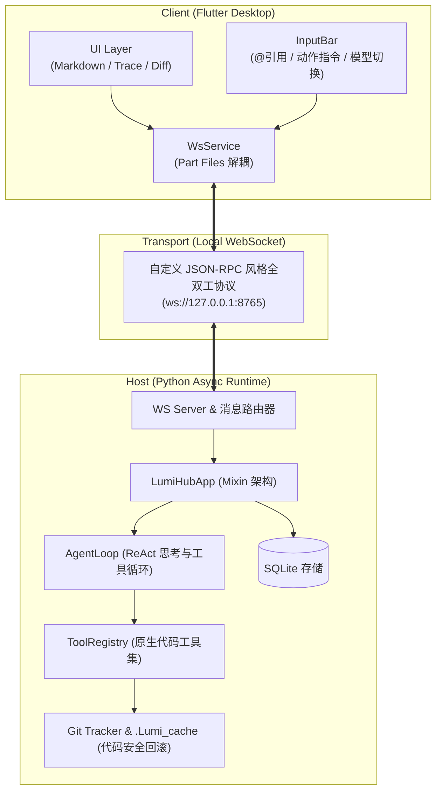

# Lumi-Hub

一个基于 **Flutter (桌面客户端)** + **Python (本地异步 Runtime)** 构建的轻量级本地交互式编码智能体（Coding Agent）。

与市面上动辄占用 1GB+ 内存的 Electron 方案（如 Cursor、Windsurf）不同，Lumi-Hub 尝试探索一种低资源占用、原生编译的轻量客户端方案：利用 Flutter 构建跨平台原生桌面 UI，通过全双工 WebSocket 与本地 Python Agent 引擎通信，实现文件外科手术式修改、ReAct 工具链循环与多模型协同。

---

## 架构与技术选型思考

### 为什么选择 Flutter + Python？
- **内存与性能敏感**：Electron 应用常驻开销大。Flutter 编译为原生二进制代码，空闲内存占用通常在 80MB 以内，在 Linux / Windows 上冷启动极快；
- **AI 表达力与高信噪比**：后端使用 Python 原生异步框架（`asyncio`），避免了 TypeScript 企业级全家桶繁重的样板代码与类型体操，直接与主流 LLM 协议及本地工具链直连。



---

## 核心工程实现

### 1. 单文件外科手术式编辑（Surgical Code Modification）
Agent 在修改大型代码库时，若直接重写整个文件，不仅消耗大量 Token，还极易丢失上下文或破坏格式。
- **`search_replace` 机制**：Agent 检索唯一的代码块并提供替换块，由底层算法做精确缩进匹配与替换；
- **安全防破坏网**：所有文件写操作执行前，均自动在工作区创建 Git 临时快照或落盘至 `.Lumi_cache`。支持在前端一键查看 Diff 并安全回滚（Revert），防止 Agent 弄脏或破坏工作区。

### 2. 状态驱动的 ReAct 循环与看门狗机制
- **动态 ReAct 循环**：支持多轮 `[思考 -> 工具调用 -> 捕获输出 -> 验证修正]` 闭环；
- **死循环看门狗（Watchdog）**：检测到 Agent 连续使用相同参数调用同一工具且未推动状态前进时，自动注入熔断干预提示，防止 Token 空耗。

### 3. 多模型配置与动态思考强度（Reasoning Effort）
- 支持 OpenAI 兼容格式、Anthropic、DeepSeek 等多模型热插拔配置；
- 支持动态切换思考等级（`Low` / `Medium` / `High`），并在客户端输入栏通过横向二级级联菜单（MenuAnchor）快速切换，满足快问与深度推理的不同场景。

### 4. 全双工通信与多端同步细节
- **回声抑制（Echo Suppression）**：客户端本地乐观渲染消息，通过 `message_id` 去重广播包，防止多端同频时自身消息重复抖动；
- **流式去重拼接**：针对 SSE / Chunk 流式文字输出，在 Dart 层引入自适应滑动重叠检测算法，解决网络不稳定时的叠字与拼接问题；
- **单一职责架构解耦**：前后端单文件超千行的大单体已彻底重构。前端通过 Dart `part` 文件解耦为 Chat、Session、LLM、Features 等子领域；后端通过 Python Mixin 将鉴权、聊天调度、工具注册、多模型管理完全物理隔离。

---

## 原生工具集 (Native Tools)

| 工具名称 | 功能描述 | 风险等级 |
| :--- | :--- | :---: |
| `read_file` | 支持基于行号分页的文件读取 | 安全 |
| `search_replace` | IDE 级唯一代码块精确外科替换 | 低 |
| `search_workspace` | 基于 Glob 模式递归检索工作区文件 | 安全 |
| `grep_code` | 快速正则与字面量代码全文搜索 | 安全 |
| `find_symbol` | 快速跨项目定位类、函数、接口符号定义 | 安全 |
| `run_command` | 宿主机 Shell 命令执行（需前端显式授权卡片批准） | 高危 |
| `delete_file` | 文件删除（受二次审批保护） | 高危 |
| `ask_user_question` | 挂起执行流并在客户端弹出多选问答交互卡片 | 安全 |

---

## 快速开始

### 依赖环境
- **Python**: `>= 3.10`
- **Flutter**: `>= 3.22` (开启 Desktop 支持)
- **操作系统**: Linux (推荐), Windows, macOS

### 1. 启动后端 Runtime
```bash
# 1. 创建并激活虚拟环境
python3 -m venv .venv
source .venv/bin/activate  # Windows: .venv\Scripts\activate

# 2. 安装依赖
pip install -r host/requirements.txt

# 3. 运行后端核心服务（默认监听 ws://127.0.0.1:8765）
python3 -m host.main
```

### 2. 运行自动化测试
```bash
# 运行后端核心功能与协议回归测试 (28 项全覆盖)
python3 host/tests/test_backend_core.py
```

### 3. 启动桌面客户端
```bash
cd client
flutter pub get

# 静态代码检查 (严格 0 警告 0 报错)
flutter analyze

# 启动 Linux/Windows 桌面客户端
flutter run -d linux   # 或 -d windows
```

---

## 目录结构

```text
├── host/                    # Python 后端 Agent 引擎
│   ├── agent_loop.py        # ReAct 主循环与上下文编排
│   ├── main.py              # 服务入口与生命周期管理
│   ├── database.py          # SQLite 本地状态与历史持久化
│   ├── handlers/            # 业务领域 Mixin 集合 (Chat/LLM/Tools/Session...)
│   ├── llm/                 # LLM Provider 抽象 (OpenAI, Anthropic, DeepSeek)
│   ├── tools/               # 原生代码操作工具实现 (含 Git 回滚)
│   └── tests/               # 核心系统单测套件
└── client/                  # Flutter 跨平台客户端
    ├── lib/
    │   ├── screens/         # 聊天界面、侧边栏、级联设置弹窗
    │   ├── services/        # WsService 核心及模块化 Part 文件
    │   └── widgets/         # Diff 查看器、问答交互卡片、执行轨迹卡片
    └── pubspec.yaml         # 前端依赖配置
```

---

## License

MIT License